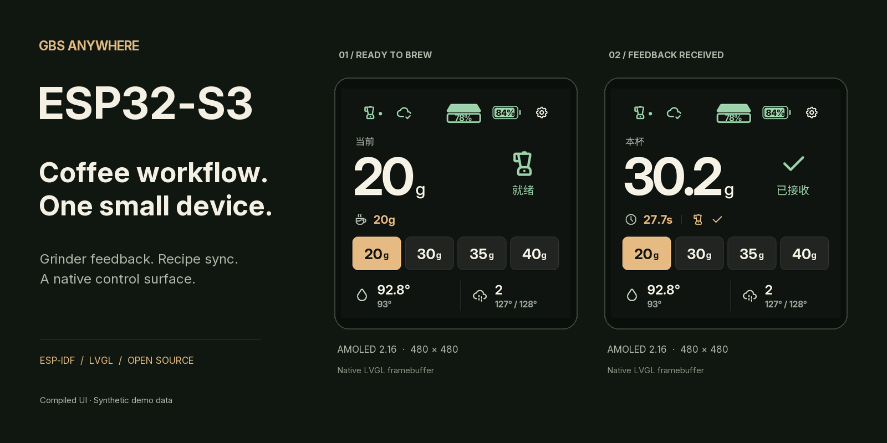
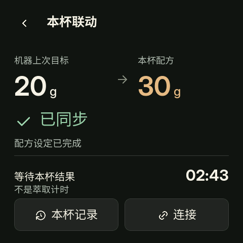
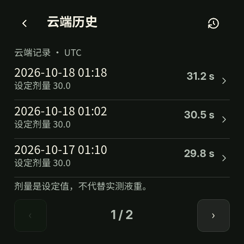

<p align="center">
  <a href="README.md">English</a> · <a href="README.zh-CN.md">简体中文</a> · <a href="README.de.md">Deutsch</a>
</p>

> **New hardware support (2026-10-28):** experimental ESP-Mosaico / ESP32-S31
> support is on [`codex/s31-mosaico-port`](https://github.com/zpmdd/gbs-anywhere-esp32/tree/codex/s31-mosaico-port).
> See the [Mosaico guide](docs/MOSAICO.md) for its 480 × 480 display, 16 MB PSRAM,
> separate SDK and validation limits. The overview below retains its earlier S3 scope.

# gbs-anywhere ESP32-S3

**用一块 ESP32-S3，连接磨豆机、咖啡机和每天的咖啡流程。**

[](https://github.com/zpmdd/gbs-anywhere-esp32/actions/workflows/ci.yml)
[](LICENSE)
[](docs/COMPATIBILITY.md)
[](docs/PROGRESS.md)

<picture>
  <source media="(max-width: 640px)" srcset="docs/images/project-cover-mobile.png">
  
</picture>

将 Mahlkönig 的 Generic WiFi 磨豆反馈与 La Marzocco Cloud 集成运行在 ESP32-S3 上，
日常使用无需电脑、Docker 或 NAS 常开。可选择小巧的无屏反馈桥，也可使用集成咖啡机控制、
配方跟随和局域网升级的触摸屏版本。首次配对与配置需要电脑。

**[开始使用](#开始使用)** · **[型号兼容表](docs/COMPATIBILITY.md)** · **[界面图库](docs/GALLERY.md)** · **[验证与路线](docs/PROGRESS.md)**

> 项目仍为实验性固件，部分指定构建已有实机验证。咖啡机控制与萃取结果依赖互联网和
> La Marzocco Cloud；反馈已接收不等于磨豆机必然调整，是否调整由磨豆机决定。

## 从磨豆到结果回传

| 步骤 | 设备完成的工作 |
| --- | --- |
| **1 · 磨豆** | ESP 接收已配对磨豆机的新 GbS 任务。 |
| **2 · 同步配方** | 集成固件从磨豆机普通 CSV 导出中匹配本次磨豆记录，在布粉准备期间设置目标液重。 |
| **3 · 萃取** | 用户核对目标后制作咖啡，咖啡机与秤提供实测时长和液重，并同步至 Cloud。 |
| **4 · 回传** | ESP 将实测结果交给磨豆机，并显示是否收到明确回执。 |

轻量版提供结果反馈，不包含配方跟随与咖啡机控制。[查看集成固件工作方式 →](docs/INTEGRATED.md)

## 主要功能

| 功能 | 使用体验 |
| --- | --- |
| **磨豆机联动** | 新任务识别、实测结果回传、监测／工作模式、连接诊断，以及重启后防止旧任务重放的持久记录。 |
| **咖啡机控制** | 快捷液重、咖啡温度、蒸汽档位、Brew-by-Weight 剂量与模式、预浸、开关机和智能待机。 |
| **配方跟随** | 根据本次磨豆记录自动选取目标液重，支持手动取消，区分处理中、已完成与结果未知。 |
| **原生屏幕** | LVGL 界面、大数字、图标与颜色、单杯详情、多杯历史及已有计划的编辑。 |
| **AMOLED 电池使用** | 秤状态与电量合并图标，设备独立电量，关机后保留最近秤电量、双锅炉预热估算、自动旋转、物理按键与节点提示音。 |
| **升级与调试** | 集成版本支持鉴权局域网 OTA、缓存诊断与真实帧缓冲预览；应用 OTA 保留 NVS 配置。 |

AMOLED 专属功能的公开源码位于
[`codex/amoled-216-local-adaptation` 分支](https://github.com/zpmdd/gbs-anywhere-esp32/tree/codex/amoled-216-local-adaptation)，
目前尚未合入 `main`。

## 界面预览

<table>
  <tr>
    <td align="center"><br><strong>配方与联动</strong></td>
    <td align="center"><br><strong>咖啡历史</strong></td>
  </tr>
</table>

截图由实际编译的 LVGL 渲染器生成，使用**合成演示数据**。画面不是实物照片，也不代表新增实机验收。
[查看预热、电量、设置及多语言网页截图 →](docs/GALLERY.md)

## 已适配的板卡与型号

| 板卡／构建 | 屏幕 · Flash／PSRAM | 源码位置 | 当前验证状态 |
| --- | --- | --- | --- |
| **Waveshare ESP32-S3-Touch-LCD-1.69** 集成版 | 240 × 280 · 16 MB／8 MB | `main` · `touchscreen` | 已有触摸、双向配方跟随实杯、OTA 和秤开／关状态验证。 |
| **Waveshare ESP32-S3-Touch-AMOLED-2.16** 集成版 | 480 × 480 · 16 MB／8 MB | AMOLED 分支 · `amoled216` | 已有旋转与触摸、PWR 开关机、电量保留和实杯验证；最新显示修正版仍待跨杯实测。 |
| **ESP32-S3 无屏轻量版** | 8 MB／8 MB octal | `main` · 根目录应用 | 已有反馈移植版本的实机证据，须区分具体构建。 |
| **ESP32-S3 无屏集成版** | 8 MB／8 MB octal | `main` · `headless` | 本地构建检查通过，独立板卡实测待完成。 |
| **1.69 英寸外接 Hub 预览版** | 240 × 280 · 16 MB／8 MB | `main` · 根目录 `GBS_TOUCHSCREEN=ON` | 已做模拟器与客户端验证，需要另一台 Hub。 |

| 咖啡设备 | 本项目的兼容范围 |
| --- | --- |
| **Mahlkönig E65W GbS** | 有实杯反馈与集成配方跟随证据，需要完成 Generic WiFi 配对。 |
| **E65T／E80W／E80T GbS** | 属于相同 Generic WiFi 协议族，本 ESP32 项目尚未逐机实测。 |
| **La Marzocco Linea Mini R** | 已验证控制、Cloud 萃取结果和 Brew-by-Weight 流程的机型。 |
| **与咖啡机配对的 Brew-by-Weight 秤** | 通过咖啡机／Cloud 取得测量与电量；AMOLED 可保留最近电量，ESP 不直接配对秤。 |
| **E64 WS／其他咖啡机** | 本移植未实现或未独立验证；上游桌面应用的 E64 WS 使用另一条协议路径。 |

不同板卡不能互刷固件。[完整兼容与功能矩阵 →](docs/COMPATIBILITY.md)

## 开始使用

1. 选择与板卡匹配的构建和 ESP-IDF 工具链。
2. 使用上游桌面版本完成首次配对，保存集成并导出私有配置。
3. 停止旧客户端，同一个磨豆机身份只保留一个工作实例。
4. 按对应指南构建和首次配置；新导入配置默认处于监测模式。
5. 等待连接与任务基线就绪，核对目标液重后再制作新的一杯。

| 使用目标 | 对应指南 |
| --- | --- |
| 1.69 英寸 LCD，一块板完成全部流程 | [集成固件：构建、配置与 OTA](docs/INTEGRATED.md) |
| 2.16 英寸 AMOLED，电池供电 | [AMOLED 分支、构建与验证状态](docs/AMOLED216.md) |
| 无屏反馈桥，通过浏览器查看状态 | [轻量版设置与 Docker 迁移](docs/COMPANION.md) |
| 已有 Hub，仅需要外接显示屏 | [外接 Hub 显示预览版](docs/TOUCHSCREEN.md) |

集成 LCD 版本使用 ESP-IDF **5.5.4**：

```sh
git clone https://github.com/zpmdd/gbs-anywhere-esp32.git
cd gbs-anywhere-esp32
. "$HOME/esp/esp-idf/export.sh"
cd firmware/integrated
sh tools/check-integrated.sh
sh tools/build-integrated.sh touchscreen
```

以上命令只构建和测试；备份、首次配置与安装步骤请使用对应板卡指南。
应用 OTA 沿用现有配置，首次 NVS 导入与日常升级是不同流程。

## 多语言

| 界面／文档 | 当前语言 |
| --- | --- |
| **项目介绍** | [English](README.md)、[简体中文](README.zh-CN.md)、[Deutsch](README.de.md) |
| **轻量版网页状态页** | 英语、德语、法语、意大利语、日语、韩语、简体中文、繁体中文 |
| **LCD／AMOLED 原生屏幕** | 当前使用中文标签，网页的 8 种翻译不等于原生屏幕也有 8 种语言。 |
| **详细技术指南** | 英文，欢迎补充翻译与修正。 |

网页会跟随浏览器语言，也可手动切换并记住选择。翻译内置于固件，不需要在线翻译服务。

## 验证、参与与许可证

- [LCD 双向配方跟随实杯记录](docs/RECIPE_FOLLOW_ACCEPTANCE.md)
- [LCD 秤状态 OTA 与开／关验证](docs/SCALE_STATE_ACCEPTANCE.md)
- [AMOLED 逐构建验证与待测范围](docs/AMOLED216.md#validation-status-2026-10-23)
- [开发进展与未完成事项](docs/PROGRESS.md)
- [参与开发与提交硬件验证结果](CONTRIBUTING.md)

开发固件尚未完成生产级 Secure Boot／Flash Encryption 认证。请保护凭据与 NVS 备份，
在可信局域网内使用；长时间运行、断网恢复与未测试机型仍需验证，构建或 CI 成功不等于实机验收。

本项目是 [Skamba/gbs-anywhere](https://github.com/Skamba/gbs-anywhere) 的独立 C／ESP-IDF 配套移植，
感谢 Skamba、erikp152 与上游贡献者。与 Rust 桌面项目分别维护，功能范围与版本号各自独立。

采用 **AGPL-3.0-or-later**，见 [LICENSE](LICENSE)、[NOTICE](NOTICE) 与 [上游对照](docs/UPSTREAM.md)。
LVGL、Noto Sans CJK、Inter、Tabler Icons 及板卡组件保留各自许可证。
本项目与 Mahlkönig、Hemro、La Marzocco、Waveshare 无隶属关系。
