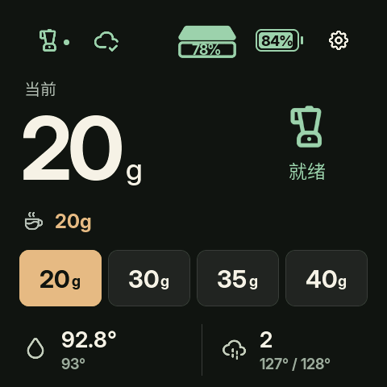
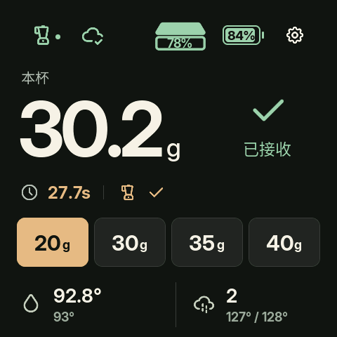
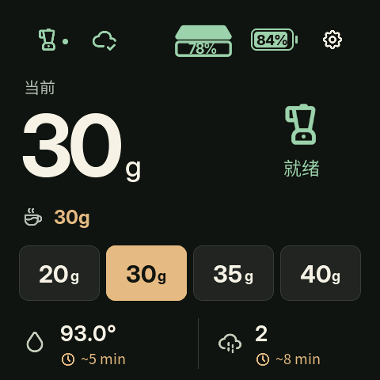
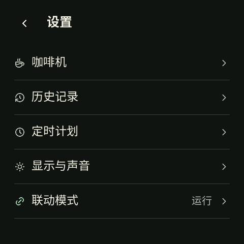
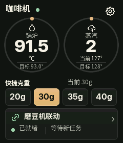
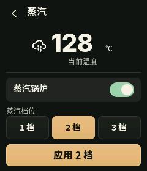
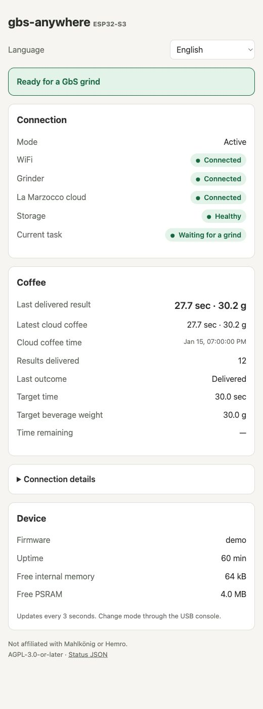
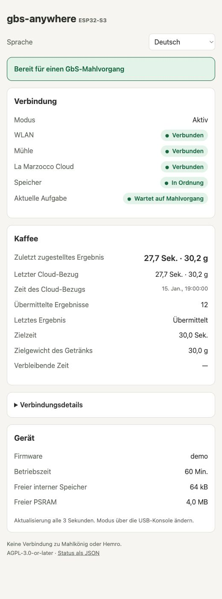

# Interface gallery

[Project overview](../README.md) · [中文](../README.zh-CN.md) · [Deutsch](../README.de.md)

Every image below uses **synthetic demo data**. Native screens come from the
compiled LVGL renderer; the browser captures run the real status-page HTML
against a local fixture. None is a device photograph, live telemetry capture
or new hardware-acceptance result. Current native screen labels are Chinese.

## 2.16-inch AMOLED · 480 × 480

Source: the public [AMOLED adaptation branch](https://github.com/zpmdd/gbs-anywhere-esp32/tree/codex/amoled-216-local-adaptation).
See its [features, setup and exact-build status](AMOLED216.md).

<table>
  <tr>
    <td align="center"> <strong>At a glance</strong> Grinder status, current target and separate batteries</td>
    <td align="center"> <strong>Measured cup</strong> Weight, duration and acknowledged delivery</td>
  </tr>
  <tr>
    <td align="center"> <strong>Recipe following</strong> Previous target, recipe target and operation status</td>
    <td align="center"> <strong>History</strong> Recorded cups in the native interface</td>
  </tr>
  <tr>
    <td align="center"> <strong>Warm-up estimates</strong> Independent coffee and steam countdowns</td>
    <td align="center"> <strong>Settings</strong> Machine, connectivity, display and system access</td>
  </tr>
</table>

An amber target outline means a setting is still being applied; a filled
preset marks the selected value. A gray scale percentage is the last observed
battery, not proof of a current connection. Warm-up times are Cloud estimates,
not a measured-ready assertion.

## 1.69-inch LCD · 240 × 280

The shared native renderer has a compact layout for the smaller display.
Integrated and external-Hub builds use different runtime connections; this
visual preview does not make their setup procedures interchangeable.

<table>
  <tr>
    <td align="center"> <strong>Compact home</strong></td>
    <td align="center"> <strong>Steam controls</strong></td>
  </tr>
</table>

[Daily control overview](images/daily-controls-preview.png) ·
[Schedule and history overview](images/schedule-history-preview.png)

## Lightweight browser status · 8 languages

The root companion serves a read-only browser page with connection status,
last delivered result and diagnostics. It selects the browser language or
remembers a manual choice. The eight translations are embedded in the firmware.

<table>
  <tr>
    <td align="center"> <strong>English</strong></td>
    <td align="center"> <strong>Deutsch</strong></td>
  </tr>
</table>

Also available: Français, Italiano, 日本語, 한국어, 简体中文 and 繁體中文.
These web translations are separate from the Chinese native LCD/AMOLED labels.
[Browser setup guide →](COMPANION.md)

See [image sources and regeneration notes](images/README.md) for provenance.
