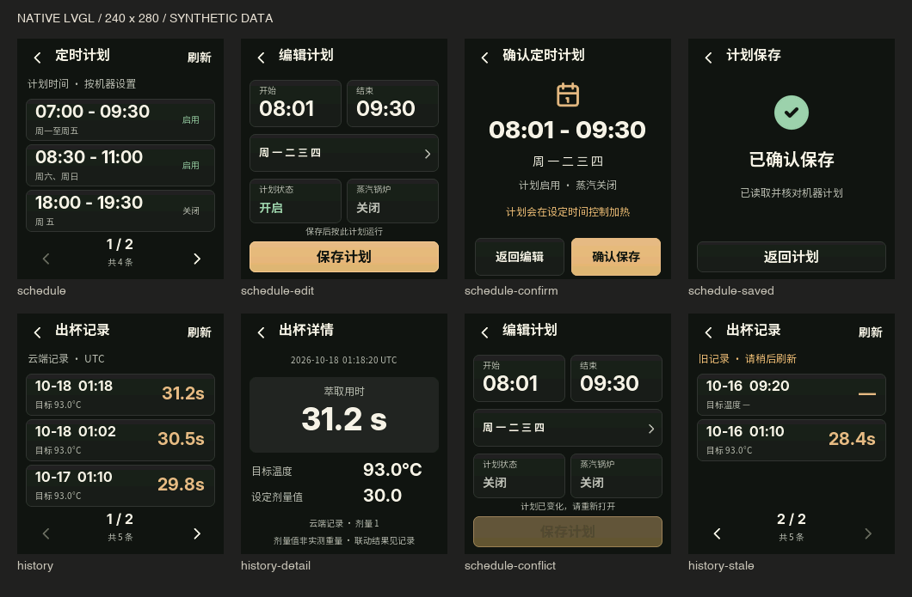
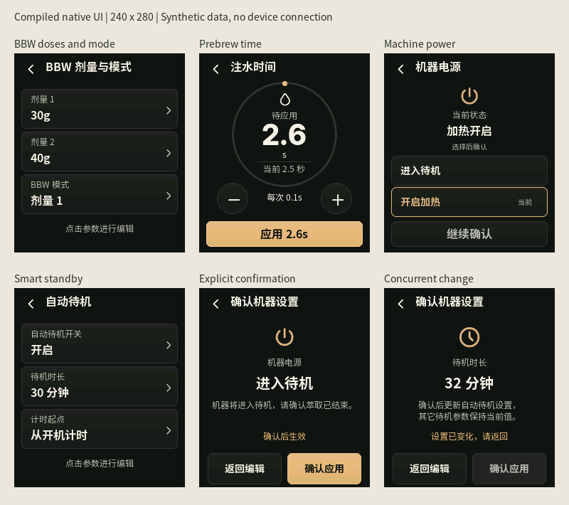

# Development progress

Updated 2026-10-18. Development branch: `codex/native-touchscreen`.
The native touchscreen and optional LamaBuddy Hub client are implemented and
locally validated. They remain experimental and have not been deployed to an
existing device or released as a hardware-accepted version.

## Latest development publication: drag input, schedules and multi-cup history

- Fixed the Mac simulator's coalesced drag/release path. Its AppKit adapter
  reads the simulator window's actual pointer coordinates before LVGL handles
  release; other platforms retain SDL input. Native CUA dragging now scrolls
  without opening the touched row, and the following tap opens the intended row.
- Added schedule list/detail/refresh plus existing-plan editing: start/end time,
  weekdays, enabled state and steam. Drafts require an explicit confirmation.
  Capability, machine binding and the expected plan are checked before one POST;
  only exact Hub readback becomes confirmed. Conflicts and unknown outcomes stay
  visible, and stale plans cannot be edited.
- Extended the separate LamaBuddy ESP32-S3 Hub with
  `POST /controls/schedule` and `scheduleEdit`. It reuses its authenticated API,
  bounded coordinator, UUID deduplication and Cloud command adapter. A fresh
  vendor read checks the original plan; a second read verifies the result. The
  schedule cache discards any read that started before the edit completed.
  The matching Hub source is isolated on `codex/hub-schedule-edit`, commit
  `7b00f00a`, based on its committed HTTPS/v2 foundation `b16ff1c9`. Other pending
  parent-workspace changes are excluded. That branch also includes the required
  local machine-binding endpoint and fixes v2 status for commands without a
  total deadline, so accepted/polled/completed schedule results remain readable.
  The display requires that matching Hub extension for editing.
- Added multi-cup list/detail/refresh using `/machine/statistics?days=7`:
  newest-first, three rows per page, at most the latest 32 returned records.
  UTC timestamps, missing metrics, old data, empty results and failures have
  explicit presentations. The Cloud dose setting is never presented as measured
  cup weight or a confirmed grinder result.
- Preserved the approved palette, Noto/Inter fonts, compact header and navigation.
  Fixed missing space, slash and temperature-unit glyphs in numeric fonts and
  added a rendered-label glyph check to the simulator regression suite.
- Published development sources on the two feature branches. Local validation
  and source publication do not establish hardware acceptance. No existing
  device, pairing, vendor Cloud session or live Hub was contacted or changed.

## Implemented baseline and additions

| Area | Implemented behavior |
| --- | --- |
| Native display | Optional 16 MB Waveshare 1.69-inch profile, shared 240 × 280 LVGL renderer and offline SDL simulator. The 8 MB headless profile remains the default. |
| Home and navigation | Two temperature dials, 20/30/35/40 g presets and a direct grinder-linkage card. Task details, recent result, editors, settings and error states share the approved V3 typography and palette. There is no permanent bottom navigation. |
| Existing bridge | Worker state, deadlines, result-delivery status and monitor/active mode use the existing implementation. Unknown delivery is not replayed or changed to success by a reconnect. |
| Hub telemetry | Authenticated HTTPS v2 reads measured and target boiler/steam temperatures. Missing measured values stay unavailable. Hub identity, machine binding, capabilities and local snapshot freshness are checked. |
| Daily controls | Smart weight selection reuses an existing matching dose or the Hub quick-weight route. Coffee temperature, three steam levels and the steam switch use existing Hub commands. Commands are confirmed only after matching readback. |
| BBW editors | Dose 1 and Dose 2 accept 0–200 whole grams. Continuous, Dose 1, Dose 2 and pulse modes use the existing Hub API. Editing a dose preserves the other dose and mode. |
| Prebrew | Mode plus independent injection/pause editors, 0–10 seconds in 0.1-second steps. Each request preserves the other prebrew fields. |
| Power and smart standby | Heating/standby, standby enablement, 1–240 minute duration and timer origin use Hub capabilities. Every change requires an explicit confirmation screen. |
| Concurrent changes | The UI's edit baseline reaches the Hub queue. Changes to any related BBW/prebrew/standby field block an outdated draft; successful command status alone is insufficient without matching readback. |
| Interaction fixes | A 30-second confirmation wait ends as unknown; stale callbacks cannot complete newer requests. Rejected/stale steam controls retain their confirmed position. Cloud errors use warning colors. |
| Provisioning | Optional private Hub trust record, certificate identity/signature validation and matching machine serial. Import preserves grinder/cloud identities and does not contact devices. |
| Local display preferences | Brightness and the fixed idle dim/blank policy are persisted. The first touch wakes a dimmed/blanked screen without activating a control. |

The preview is compiled LVGL output with synthetic data. See the
[interface and Hub contract](TOUCHSCREEN.md) and [design QA](../design-qa.md).

## Validation status

| Check | Status and limit |
| --- | --- |
| Host C tests | Passed with ASan/UBSan: protocol, production worker, display model and production Hub contract using in-memory services. Daily actions and schedule edits cover one-POST behavior, lost replies, capability rejection, concurrent changes, partial/unknown results and preserved-field readback. |
| Provisioning and helpers | 11 provisioning tests and 8 serial-helper tests passed. Real NVS image generation uses synthetic credentials/certificates in temporary directories. |
| Web status UI | Eight locales, startup/offline states and storage restrictions passed. |
| Native UI | All 38 routes render; navigation, list swipe, draft conflicts, duplicate locking, timeout, late-result, steam-switch and daily-control regressions passed. The original 18 design comparisons remain the baseline; schedule/history pages reuse their fonts, palette and widgets. The new suite covers refresh, paging, details, schedule draft/confirmation/conflict/timeout and missing glyphs. |
| Native application | Native CUA passed drag-to-scroll followed by a correct row tap, schedule edit/confirmation/pending/confirmed feedback, and history pagination/detail with missing metrics. All data was synthetic; this is not physical-touch or live-Hub evidence. |
| Hub extension | The isolated committed baseline passed production schedule parser/transaction/cache/binding tests with ASan/UBSan, 27 coordinator cases (including v2 status across 11 non-deadline command kinds), 8 control cases, the slow-read validator and 6 HTTPS/identity contract groups. The original workspace also passed its broader existing regressions after the scoped fixes. |
| Firmware builds | Both ESP-IDF 5.5.4 companion profiles and the isolated Hub build passed. Application-partition free space is 74% headless, 56% touchscreen and 27% Hub. The headless ELF contains neither Hub client nor LVGL symbols. |
| Hosted CI | The workflow includes offline tests, the native self-test and both firmware profiles. Use the [branch workflow results](https://github.com/zpmdd/gbs-anywhere-esp32/actions/workflows/ci.yml?query=branch%3Acodex%2Fnative-touchscreen) for commit-specific evidence; local success alone does not establish CI success. |
| Hardware / release | Pending. No flashing, pairing, existing Hub requests, machine writes or real shots were performed for this development round. |

## Remaining work, in order

1. **Dedicated display-board acceptance, after explicit authorization.** Use the
   16 MB board/profile and validate panel orientation, touch coordinates, color,
   brightness, idle dimming and wake behavior against the exact candidate binary.
   Existing 8 MB deployments are not targets for this display image.
2. **Live Hub acceptance, after explicit authorization.** Validate trusted TLS
   and serial binding, then measured/target temperature freshness. Check presets,
   preserved doses/modes, prebrew, power, standby, coffee temperature and steam
   controls with real readback; then validate schedule edits, machine timezone,
   delayed readback and multi-cup history against the matching Hub extension;
   exercise rejected, partial, unknown and concurrent-change outcomes.
3. **Reliability and coexistence.** Observe task-stack/heap margins and prolonged
   operation with display, Hub traffic and the existing grinder/cloud worker.
   Test daily power cycles, WiFi interruption, Hub restarts and token expiry.
   Repeat real-shot feedback acceptance on the exact build; precursor results
   do not establish this candidate's behavior.
4. **Review and release.** Keep the work on the development branch until review
   and applicable CI/hardware gates pass. Record exact firmware revision and
   results before calling it released or hardware accepted. No firmware release
   or main-branch merge is part of this local development round.

These hardware-dependent items are deferred while the instruction to leave
existing devices untouched remains in effect.

The local feature backlog is separate from those acceptance gates:

1. Schedule creation/deletion, if requested; this round edits existing plans only.
2. Independent idle dim/blank timers; the current two rows share one fixed policy.
3. On-device setup and OTA, with an explicit storage/update design before implementation.
4. Optional history timezone preference; current Cloud records are explicitly UTC.

Setup and update guidance pages are not completed editing workflows. Future
controls should continue to reuse Hub capabilities and command semantics.

## Upstream synchronization

The local check fetched both `origin` and `upstream` on 2026-10-18.
Companion main remains `b4c1e51`; Skamba upstream main is
`b8f7dc28c0c00585ebe3cd574bcde5f783e412e5` (PR22 tabs, PR23 settings, PR24 history).
The new protocol/worker changes were reviewed: configurable timeout, worker-owner
checks, history attribution and HTTP reachability bookkeeping. This companion
keeps its fixed bounded timeout, imported identity, single worker and persistent
journal; there is no runtime endpoint replacement or E64 manual-brew path to port.
The protocol behavior baseline remains `3adf778`.

Keep the companion and upstream Rust histories separate. Port relevant fixes
with regression tests and record decisions in [UPSTREAM.md](UPSTREAM.md).
This round is published as development source on `codex/native-touchscreen` and
on the separate Hub branch above. It is not a firmware release or deployment.
Hosted CI must be checked for the new companion commit; the Hub branch currently
has local build/test evidence only.
