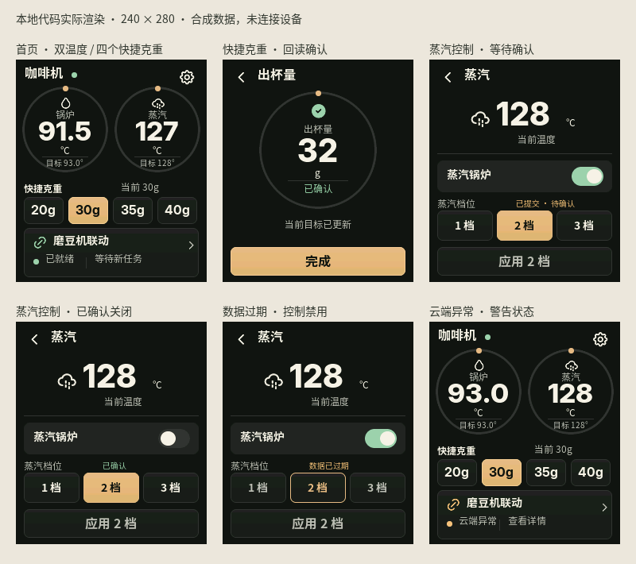

# Development progress

Updated 2026-10-17. Development branch: `codex/native-touchscreen`.
The native touchscreen and optional LamaBuddy Hub client are implemented and
locally validated. They remain experimental and have not been deployed to an
existing device or released as a hardware-accepted version.

## Completed in this development round

| Area | Implemented behavior |
| --- | --- |
| Native display | Optional 16 MB Waveshare 1.69-inch profile, shared 240 × 280 LVGL renderer and offline SDL simulator. The 8 MB headless profile remains the default. |
| Home and navigation | Two temperature dials, 20/30/35/40 g presets and a direct grinder-linkage card. Task details, recent result, editors, settings and error states share the approved V3 typography and palette. There is no permanent bottom navigation. |
| Existing bridge | Worker state, deadlines, result-delivery status and monitor/active mode use the existing implementation. Unknown delivery is not replayed or changed to success by a reconnect. |
| Hub telemetry | Authenticated HTTPS v2 reads measured and target boiler/steam temperatures. Missing measured values stay unavailable. Hub identity, machine binding, capabilities and local snapshot freshness are checked. |
| Daily controls | Smart weight selection reuses an existing matching dose or the Hub quick-weight route. Coffee temperature, three steam levels and the steam switch use existing Hub commands. Commands are confirmed only after matching readback. |
| Interaction fixes | A 30-second confirmation wait ends as unknown; stale callbacks cannot complete newer requests. Rejected/stale steam controls retain their confirmed position. Cloud errors use warning colors. |
| Provisioning | Optional private Hub trust record, certificate identity/signature validation and matching machine serial. Import preserves grinder/cloud identities and does not contact devices. |
| Local display preferences | Brightness and the fixed idle dim/blank policy are persisted. The first touch wakes a dimmed/blanked screen without activating a control. |

The preview is compiled LVGL output with synthetic data. See the
[interface and Hub contract](TOUCHSCREEN.md) and [design QA](../design-qa.md).

## Validation status

| Check | Status and limit |
| --- | --- |
| Host C tests | Passed with ASan/UBSan: protocol, production worker, display model and production Hub contract using in-memory services. |
| Provisioning and helpers | 11 provisioning tests and 8 serial-helper tests passed. Real NVS image generation uses synthetic credentials/certificates in temporary directories. |
| Web status UI | Eight locales, startup/offline states and storage restrictions passed. |
| Native UI | All 23 routes render; navigation, draft conflicts, duplicate locking, timeout, late-result and steam-switch regressions passed. Eighteen states were compared with the approved design. |
| Native application | Local pointer interaction observed the steam switch retaining its position while pending and changing after confirmation. |
| Firmware builds | Both ESP-IDF 5.5.4 profiles passed. The headless ELF contains neither Hub client nor LVGL symbols. |
| Hosted CI | The workflow includes offline tests, the native self-test and both firmware profiles. Use the [branch workflow results](https://github.com/zpmdd/gbs-anywhere-esp32/actions/workflows/ci.yml?query=branch%3Acodex%2Fnative-touchscreen) for commit-specific evidence; local success alone does not establish CI success. |
| Hardware / release | Pending. No flashing, pairing, existing Hub requests, machine writes or real shots were performed for this development round. |

## Remaining work, in order

1. **Dedicated display-board acceptance, after explicit authorization.** Use the
   16 MB board/profile and validate panel orientation, touch coordinates, color,
   brightness, idle dimming and wake behavior against the exact candidate binary.
   Existing 8 MB deployments are not targets for this display image.
2. **Live Hub acceptance, after explicit authorization.** Validate trusted TLS
   and serial binding, then measured/target temperature freshness. Check presets,
   preserved doses, coffee temperature and steam controls with real readback;
   exercise rejected, partial, unknown and concurrent-change outcomes.
3. **Reliability and coexistence.** Observe task-stack/heap margins and prolonged
   operation with display, Hub traffic and the existing grinder/cloud worker.
   Test daily power cycles, WiFi interruption, Hub restarts and token expiry.
   Repeat real-shot feedback acceptance on the exact build; precursor results
   do not establish this candidate's behavior.
4. **Review and release.** Keep the work on the development branch until review
   and applicable CI/hardware gates pass. Record exact firmware revision and
   results before calling it released or hardware accepted. No firmware release
   or main-branch merge is part of this publication step.

These hardware-dependent items are deferred while the instruction to leave
existing devices untouched remains in effect.

The later feature backlog is separate from those acceptance gates: full BBW
dose/mode editing, prebrew, power/standby, schedules, multi-cup history, independent
idle timers, on-device setup and OTA. Their placeholder routes are not completed
features. Future controls should continue to reuse Hub capabilities and command
semantics rather than introducing another machine-control implementation.

## Upstream synchronization

The publication check fetched both `origin` and `upstream` on 2026-10-17.
Companion main was `b4c1e51`; Skamba upstream main remained
`c60eade2cb1f39a4f2123aa7c9bd5f4e4acba759`. There were no new changes since the
previous upstream check. Protocol behavior remains based on `3adf778`; the
intervening PR21 changes do not require a protocol port.

Keep the companion and upstream Rust histories separate. Review new upstream
changes, port relevant fixes with regression tests, and update
[UPSTREAM.md](UPSTREAM.md). Publication does not deploy firmware or alter pairing.
